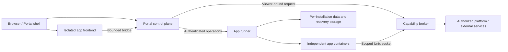

# Architecture and product behavior

Status: proposal. Read [the plan index](README.md) for approval gates.

## 1. Product surfaces

There are four connected surfaces, not four separate products:

1. **My apps:** authorized installed apps, pinned shortcuts and meaningful states.
   An ordinary user cannot see hidden app counts or administrator diagnostics.
2. **Market:** searchable application descriptions, publisher identity, release
   channel, compatibility, permissions, resource requirements and install action.
3. **Application page:** one Portal header/title/action area and app content.
4. **Application management:** install/update operations, access, capabilities,
   credentials, background activity, data, backups and sanitized diagnostics.

Opening a disabled app shows a platform-owned explanation, not an endless spinner.
An administrator sees a recovery action. A reader sees only a safe availability
message. Detail pages and deep links recheck authority before returning content.

## 2. Process and repository boundaries

This is a logical diagram. The initial broker can be a separately bounded package
in the runner executable; it must not share the privileged container-control API
with app callers. Identity verification and platform capability authorization
remain Portal responsibilities. Broker destination policy is enforced at the
network operation, not merely in a frontend validator.

| Owner | Source location, proposed where new | Responsibility |
| --- | --- | --- |
| Portal | Existing `internal/app/apps_*`, `extension_*`, `web/src` | User authority, catalogue, reviewed plans, durable lifecycle intent, host UI |
| Runtime | New `cmd/app-runner`, `internal/apprunner` | Containers, volumes, resource enforcement, local operation journal and reconciliation |
| Generic contracts | New `internal/appplatform` initially | Pure validation/state machine interfaces; no dependency on app business packages |
| SDK and app packaging | Shared Apps repository | SDK, templates, package validators and app-qualified publication |
| Application | `apps/<id>` in shared Apps repository | Business logic and data semantics within declared capabilities |

Do not move unrelated report, forecast or batch code during this project. Follow
[ADR 0016](../adr/0016-app-package-architecture.md): use cohesive domain packages
and narrow interfaces; the existing Store/Server methods remain in their package.

## 3. Runner deployment and trust

The initial supported managed runtime is Linux Docker, preferably rootless where
the required isolation/quota tests pass. The runner is infrastructure, installed
once by the runtime administrator. Static apps require no runner.

- Portal never receives a Docker socket. App containers never receive one either.
- The runner's Docker access is security-critical. Moving it to another process
  limits exposure but does not make that privilege harmless. Rootful installations
  must explicitly acknowledge host-level risk; validate both supported modes.
- The reference deployment uses an owner-only Unix control socket. If Portal is
  containerized, mount only that socket and required public trust material.
- A remote runner is not supported in the first release. Do not expose the control
  socket as unauthenticated TCP. Future remote support requires a separate mTLS
  enrollment, revocation and node-authority design.
- App installation data, permissions and sources are web-managed. Endpoint/key
  infrastructure belongs in the narrow runtime bootstrap configuration. Do not
  put catalogue, OU policy or per-app feature settings in Portal `config.yaml`.
- Installation preflight verifies runtime availability, architecture, disk, quota
  support and package policy. Failure happens before the install confirmation.

## 4. Container and network model

Reference managed apps run non-root, read-only root filesystem, dropped Linux
capabilities, no-new-privileges, finite memory/CPU/PID/log/temp/data limits and a
bounded termination deadline. No privileged mode, host PID namespace, host network,
device mounts, arbitrary host paths or app-supplied Docker arguments are accepted.
Container isolation is not a guarantee against kernel/runtime vulnerabilities.

The proposed default is `network=none`; app/backend and broker communication use
distinct per-installation Unix sockets. The app contract requires an HTTP server
on the provided socket path. The runner must own parent directories and prevent
symlink/path substitution. Do not expose app ports on the host.

External traffic uses a broker request with a declared destination capability:

- HTTP mode: fixed approved origin, methods, paths, size/deadline limits, redirect
  refusal, TLS verification, DNS-all-address validation and dial-time pinning.
- Restricted stream mode: only when explicitly granted for a database or another
  non-HTTP protocol; fixed destination/port, byte/time/concurrency limits, validated
  DNS and transport policy. It is not a generic CONNECT proxy. Define a fixture
  protocol and refusal tests before enabling this capability.
- Default denial of metadata, link-local, unspecified and other reserved targets.
  Private service access needs a separately reviewed narrow network rule.
- TLS-verifying applications must retain end-to-end hostname verification where
  streams carry TLS. The broker must not silently downgrade transport.

A Docker bridge by itself does not enforce domain or port grants. If the selected
driver cannot prove broker-only egress, mark managed apps unsupported; do not ship
a permissive network as a temporary substitute. Browser frontend CSP also denies
direct external network requests; frontend activity uses the platform bridge.

## 5. UI integration without shared application authority

The Portal shell owns navigation, title, breadcrumbs, page actions, scroll,
loading/error surfaces and theme. The app document owns business content only.

- One visible title, one breadcrumb chain, no outer app border, no default app
  website header, no second theme/language controls, no version row in content.
- App version and runtime details belong in management/app information.
- The host sets the initial color scheme before navigation. Keep child content
  unpainted until trusted presentation data is applied; bound a missing handshake
  and show a host error. Do not flash guessed light surfaces.
- Use a seamless sandboxed document, not downloaded code in Portal's React tree.
  Preserve the lack of `allow-same-origin`, top navigation and popup authority.
- Normal document pages use one outer page scroll. Child content height is
  measured, coalesced and bounded by the negotiated contract. Oversized or rapidly
  oscillating measurements fall back to a controlled viewport with an explicit
  error; they do not grow the DOM indefinitely.
- Full-height editors may request a registered viewport layout with app-owned
  content scrolling. It is an explicit layout mode, not an accidental nested scroll.
- Platform-hosted dialogs use typed field/action descriptors with app-scoped
  callbacks. A custom child dialog remains inside its document and must support
  keyboard/focus tests; it cannot paint over trusted permission prompts.
- Page actions and subtitles are bounded text/action descriptors. App-provided
  HTML, scripts, arbitrary host CSS and executable callbacks are forbidden.

React and Ant Design are bundled in each app package. Sharing a development
foundation does not imply sharing the host React runtime or importing arbitrary
third-party modules into it. Existing legacy apps remain in their old host until
explicitly migrated; the v2 shell must not silently promise compatibility.

## 6. Platform capabilities and ownership

| Capability | Platform responsibility | Application responsibility |
| --- | --- | --- |
| Identity/OU | Current account, generation, role, verified ancestry and app access | Resource-level policy; no inference from names or numeric IDs |
| Data | Isolated data volume/file API, quota and recovery plumbing | Domain model, schema version and app migration implementation |
| Credentials | Purpose-sealed vault, binding, revocation and redaction | Explain which service needs access and minimize secret handling |
| Jobs | Persistent schedule, lease, timeout, retry/backoff, cancellation | Idempotent handler, classified failures and business semantics |
| Events | Authorized subscriptions, bounded delivery and replay metadata | Idempotent consumption; no unauthorized global event reads |
| Notifications | Existing ADR 0038 capture, routes and recipient authority | Occurrence identity, safe localized message and resource reference |
| Navigation | Registered routes, back/forward, authorized deep links | Route content and draft guards |
| Diagnosis | Health, bounded sanitized logs, resource measurements | Safe health contract; no sensitive values in logs |

Default credential mode is broker use: an app requests an authorized operation
without receiving the raw secret. Some protocols require the app to receive secret
bytes; that must be a separately reviewed capability. A vault cannot prevent an
app from leaking a raw secret it is explicitly allowed to read. Revocation must
also account for in-flight work and any credential copies already supplied.

## 7. Scope limits that prevent accidental platform expansion

Use one containerized backend per managed installation in the first adapter.
Do not support app-supplied sidecars, Compose files or a dependency graph of
arbitrary third-party apps. Platform services cover common storage/tasks/events;
library dependencies are bundled and verified with the package. Resource demands
that exceed the approved adapter are rejected before installation.

The platform must provide both online viewer-bound calls and explicitly granted
background service calls. A background worker has no administrator user session;
its authority is app-owned, narrower than a user and separately revocable. It
cannot select an arbitrary user to impersonate.

Status is not the architecture fixture. The acceptance apps are a static Notes
sample and a managed Scheduled Digest sample with local fake destinations.
Neither requires real financial data, paid inference or production credentials.
